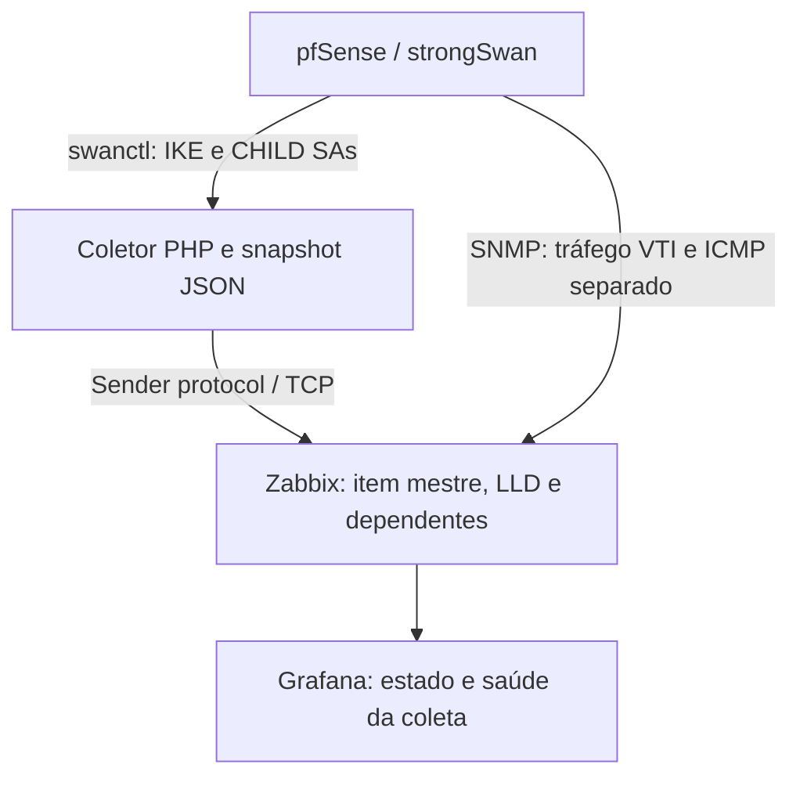

# Observabilidade de VPNs IPsec com pfSense, Zabbix e Grafana

Estudo de caso de engenharia de monitoramento: transformar o estado das associações IPsec em indicadores por unidade, automatizar a descoberta de túneis e acompanhar a saúde da própria coleta.

**Versão pública sanitizada.** Nomes, identificadores, endereços e valores dos exemplos são fictícios. Nenhum print, log, arquivo de configuração ou captura de pacotes do ambiente original está incluído.

## Problema

O estado operacional de uma interface e a resposta a ping não descrevem, isoladamente, a situação de uma VPN. Era necessário reunir estado IPsec, tráfego e conectividade em um dashboard, incluindo VPNs com interfaces VTI e VPNs baseadas em políticas.

## Solução



O Cron executa a coleta e o envio a cada minuto. Um único JSON alimenta o item mestre; descoberta de baixo nível (LLD) cria os itens por VPN. O Grafana consulta o Zabbix e exibe estado, tráfego de entrada e saída, perda e latência em painéis distintos.

## O que foi desenvolvido

- Coleta de associações IKE e CHILD pelo `swanctl --list-sas --raw`.
- Correlação de VTI por `reqid` e de VPN baseada em políticas por conexão e CHILD esperado.
- Inventário esperado para manter VPNs desconectadas na descoberta.
- Separação entre falha de coleta e indisponibilidade de túnel.
- Gravação atômica do snapshot e envio em PHP pelo protocolo Sender.
- Itens dependentes, protótipos e indicadores de sucesso e atualização da coleta.
- Dashboard com estados legíveis, séries de tráfego e tabelas de conectividade.
- Automação pelo pacote Cron do pfSense com bloqueio contra execuções simultâneas.

## Critério de estado

| Indicador | Critério |
| --- | --- |
| UP | IKE `ESTABLISHED` e todos os CHILDs esperados `INSTALLED` |
| DOWN | Nenhum CHILD esperado instalado sob IKE estabelecido |
| PARCIAL | Apenas parte dos CHILDs esperados instalada |
| Coleta inválida | Erro de consulta ou parsing; não equivale a todas as VPNs DOWN |

`INSTALLED` indica que a associação de segurança de dados está instalada. Esse estado não garante funcionamento de aplicações: rotas, regras e conectividade ponta a ponta precisam de verificações adicionais.

## Conteúdo

- [Arquitetura e decisões](docs/architecture.md)
- [Configuração manual no Zabbix](docs/zabbix.md)
- [Construção do dashboard](docs/grafana.md)
- [Operação e troubleshooting](docs/operations.md)
- [Privacidade e escopo público](docs/privacy.md)
- [Snapshot fictício](examples/status.json)
- [Validação dos exemplos](tools/validate_examples.py)

## Escopo e validação

Este repositório documenta uma implementação realizada com PHP 8.2, Zabbix 7.0 e Grafana com datasource Zabbix. O material público contém documentação e fixtures sintéticas; **não inclui os scripts completos de produção, um template importável ou export do dashboard**. Não é um instalador pronto para produção.

Na implementação acompanhada, foram verificados sintaxe PHP, leitura do snapshot, aceite do envio pelo Zabbix, descoberta de itens e registros sucessivos separados por um minuto. Esses resultados não constituem teste de compatibilidade para outras versões. A validação local deste repositório verifica somente os exemplos sintéticos.

```sh
python3 tools/validate_examples.py
```

## Competências demonstradas

IPsec e strongSwan, PHP CLI, JSON, protocolo Sender, Zabbix LLD e JSONPath, SNMP, Grafana, agendamento em FreeBSD/pfSense e diagnóstico com logs e captura de pacotes.

## Referências oficiais

- [strongSwan: swanctl --list-sas](https://docs.strongswan.org/docs/latest/swanctl/swanctlListSas.html)
- [Zabbix 7.0: dependent items](https://www.zabbix.com/documentation/7.0/en/manual/config/items/itemtypes/dependent_items)
- [Grafana: Stat](https://grafana.com/docs/grafana/latest/visualizations/panels-visualizations/visualizations/stat/)
